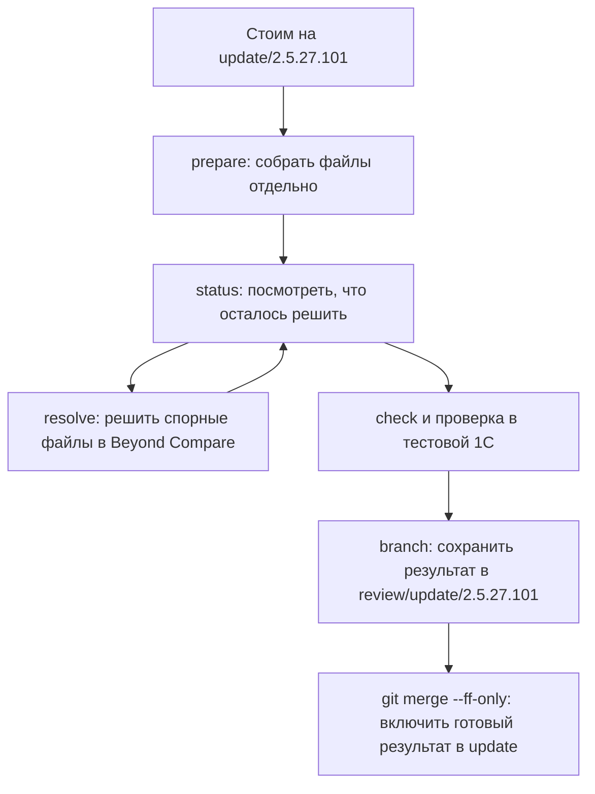

# Как обновить свою конфигурацию из vendor

У вас уже есть ветка `update/2.5.27.101`, созданная от master. В ней — ваша конфигурация с доработками. В `vendor/2.5.27.101` — новая типовая конфигурация. Нужно получить **новую типовую с сохранёнными нашими доработками** и поместить результат в update.

Представьте отдельный рабочий стол. merge1c раскладывает на нём старую общую версию, нашу конфигурацию и новую типовую, затем собирает результат. Этот стол — папка **сессии**. Собранные файлы лежат внутри неё, в папке **candidate**. Вы можете рассмотреть и поправить их до изменения update.

Работа проходит так:



**До последнего шага файлы вашей update-ветки остаются прежними.** `prepare` готовит результат на диске, `branch` создаёт отдельную ветку, а `git merge --ff-only` передвигает update на готовый результат.

Ниже весь путь разобран для одного случая. Во всех командах используются одни и те же имена:

| Что | Значение |
|---|---|
| Репозиторий | `C:/REP/erp` |
| Куда включаем обновление | `update/2.5.27.101` |
| Откуда берём обновление | `vendor/2.5.27.101` |
| Папка сессии | `C:/REP/merge-sessions/update-2.5.27.101` |
| Файлы результата | `C:/REP/merge-sessions/update-2.5.27.101/candidate` |
| Новая ветка с результатом | `review/update-2.5.27.101` |

## 1. Проверить установленную программу

Для примеров ниже используется Python-вариант:

```text
python -m merge1c --version
```

Для этой инструкции ожидается `merge1c 0.1.3`. Если установлена предыдущая версия, обновите её:

```text
python -m pip install --upgrade "C:/i-merge/merge1c/dist/merge1c-0.1.3-py3-none-any.whl"
```

Укажите свой путь к wheel, если проект находится в другом месте. Нужны Python 3.11+ и Git 2.50+. Готовая Windows-поставка также работает без установленного Python: распакуйте ZIP целиком, сохраните `_internal` рядом с exe и добавьте папку exe в PATH. **При работе через exe во всех дальнейших командах замените `python -m merge1c` на `merge1c`; остальные аргументы остаются теми же.** Установка и сборка описаны в [README](../README.md) и [разработке](development.md#собрать-поставку).

`No module named merge1c` означает, что выбранный Python не находит установленную библиотеку. Устанавливайте её через `python -m pip`, чтобы установка и запуск использовали один Python. Добавление исходников в PATH не заменяет установку.

## 2. Подготовить update и настройки

Переключитесь на **уже существующую** update-ветку и проверьте состояние:

```text
git -C "C:/REP/erp" switch update/2.5.27.101
git -C "C:/REP/erp" status
```

Нужные выгрузки 1С должны быть закоммичены. Незакоммиченные изменения не входят в снимки merge1c. Если Git сообщает о незавершённом merge, rebase или cherry-pick, сначала разберитесь с этой операцией. Обычную команду `git merge vendor/2.5.27.101` перед `prepare` выполнять не нужно.

Если `merge1c.toml` уже существует, используйте его. `init` нужен только при первом запуске в новом репозитории:

```text
python -m merge1c init "C:/REP/erp"
```

В `C:/REP/erp/merge1c.local.toml` проверьте место для сессий и пути программ. Например:

```toml
[storage]
session_root = 'C:/REP/merge-sessions'

[git]
executable = 'C:/Git/cmd/git.exe'

[tools.beyond_compare]
executable = 'C:/Program Files/Beyond Compare/BCompare.exe'
```

Это пути вашего компьютера. Убедитесь, что exe действительно находятся там. Если эти разделы уже есть, исправьте значения в них; второй раз добавлять те же разделы не нужно. Локальный файл исключите из Git. Папка сессий должна находиться вне `C:/REP/erp`; соседняя `C:/REP/merge-sessions` подходит.

В общем `C:/REP/erp/merge1c.toml` для вашей выгрузки выберите корень исходников:

```toml
[project]
source_roots = ['src/cf']
```

Это относительный путь внутри репозитория. Если нужно обрабатывать и XML/BSL расширений, добавьте их фактические каталоги в список. Пустой список `[]` обрабатывает всё дерево. Остальные файлы также сохраняются в результате — список не исключает их из копирования.

### Как будем проверять 1С

В этой инструкции вы проверяете результат в Конфигураторе вручную. **До создания сессии** найдите в общем TOML раздел `[validation]` и установите:

```toml
[validation]
require_platform = false
```

Это позволяет создать review-ветку после встроенных и настроенных дополнительных проверок. Это не означает, что 1С проверена: в отчёте останется `platform: not_run`. Перед включением результата в update потребуется ваша проверка в отдельной тестовой базе.

Значение по умолчанию — `true`. Оно предназначено для автоматического маршрута: настроенная проверяющая программа должна выполнить проверки 1С и вернуть отчёт. Готового универсального адаптера установленной 1С в библиотеке пока нет. Если оставить `true` без такого адаптера, файлы подготовятся, но `check` не подтвердит готовность и `branch` будет заблокирован. Контракт адаптера описан в [настройках](configuration.md).

Правила запоминаются в начале сессии. Изменение TOML после `prepare` не меняет уже созданную сессию. Для других правил нужна новая сессия; редактировать `session.json` не следует.

Проверьте место хранения:

```text
python -m merge1c doctor --repo "C:/REP/erp" --storage-only
```

Успех означает, что создание, запись, чтение, замена, переименование и удаление пробных файлов доступны сейчас. Это не проверка XML, BSL или работоспособности 1С. Существующие ACL и файлы программа не меняет.

## 3. Один раз подготовить слияние

Выполните:

```text
python -m merge1c prepare vendor/2.5.27.101 --repo "C:/REP/erp" --session "C:/REP/merge-sessions/update-2.5.27.101"
```

Что именно используется:

| Название в программе | В вашем случае |
|---|---|
| `local` — наше | Закоммиченный HEAD текущей `update/2.5.27.101` |
| `incoming` — входящее | Коммит `vendor/2.5.27.101` |
| `base` — общее старое | Единственный общий предок, который найдёт Git |

Base не нужно выгружать или указывать вручную. Обычно он связан с прежней поставкой, но программа определяет его по реальной истории Git.

merge1c выгрузит эти три версии, сопоставит объекты, перенесёт независимые изменения и запишет результат отдельно. Папка сессии в этой команде должна быть новой. Программа не заменяет существующую сессию.

Во время выгрузки показываются сторона, число файлов и прочитанный объём: сначала общее основание, затем наша ветка, затем входящая. Эти числа описывают текущий снимок, а не процент готовности всего обновления. После выгрузки начнутся объединение и проверка структуры.

После успешной подготовки откройте:

```text
C:/REP/merge-sessions/update-2.5.27.101/candidate/src/cf
```

Это объединённые исходники конфигурации. В `C:/REP/erp` файлы пока прежние. Внутри сессии также появились:

| Путь | Для чего нужен |
|---|---|
| `candidate/` | Результат, который можно смотреть и исправлять |
| `inputs/base`, `inputs/local`, `inputs/incoming` | Сохранённые исходные версии; не редактируйте их |
| `report.json` | Полный список замечаний и текущее состояние |
| `session.json` | Состояние сессии и сохранённые настройки |
| `events.jsonl` | Журнал действий |
| `resolutions/` | Копии файлов и история ручных решений |

Если программа подготовила файлы, но сообщила о конфликтах, это рабочий этап. Не запускайте `prepare` повторно для решения этих конфликтов — переходите к `status`.

## 4. Посмотреть, что осталось решить

```text
python -m merge1c status "C:/REP/merge-sessions/update-2.5.27.101"
```

Смотрите состояние и пути файлов в замечаниях:

| Что написано | Что это значит | Следующее действие |
|---|---|---|
| Есть нерешённые случаи (`conflicts`) | Программа не смогла уверенно выбрать результат либо нашла ошибку структуры | Разобрать указанные файлы, как в следующем шаге |
| Подготовлен, нужны проверки (`prepared`) | Файловые вопросы решены, но ещё не пройдены обязательные проверки | Выполнить `check --run-tools`; посмотреть, какой проверки не хватает |
| Проверки по настройкам пройдены (`ready`) | Текущие файлы прошли проверки, выбранные для этой сессии | Проверить их в тестовой 1С, затем создать review-ветку |

На экране выводится до 20 замечаний. Все замечания есть в `report.json`. Отдельно проверяйте строку о платформе: при ручном маршруте `не запускалась` — ожидаемый результат, потому что библиотека не управляла Конфигуратором.

## 5. Решить спорные файлы в Beyond Compare

Возьмите **относительный путь файла из своего отчёта**. Например, если отчёт указывает `src/cf/CommonForms/ИмяФормы/Ext/Form.xml`, команда такая:

```text
python -m merge1c resolve "C:/REP/merge-sessions/update-2.5.27.101" "src/cf/CommonForms/ИмяФормы/Ext/Form.xml" --tool beyond_compare
```

`ИмяФормы` здесь — пример. Подставьте настоящий путь, показанный вашим `status`.

В программу передаются копии трёх сторон и отдельный файл результата. `local` — наши файлы из update, `incoming` — новая типовая из vendor, `base` — общее старое состояние. Согласуйте нужные изменения, сохраните результат в предложенный файл и завершите работу с этим окном Beyond Compare. merge1c дождётся программы, примет её результат и снова проверит файл. Дополнительный `--accept` после успешного `--tool` не нужен.

Если Beyond Compare не установлен или путь неверен, исправьте путь до подготовки новой сессии. В действующей сессии уже сохранены настройки. Ошибка, отмена или отсутствие файла результата не считаются готовым решением.

Повторяйте `resolve` для оставшихся файлов, затем снова посмотрите `status`. Ошибка разбора XML или дубль в BSL не исчезнут только от подтверждения решения: их нужно исправить в самом результате.

### Если удобнее править файл вручную

Редактируйте файл внутри `candidate`, а не внутри `inputs` и не в рабочем `C:/REP/erp`. Для файла с нерешённым конфликтом подтвердите готовую правку:

```text
python -m merge1c resolve "C:/REP/merge-sessions/update-2.5.27.101" "src/cf/CommonForms/ИмяФормы/Ext/Form.xml" --accept
```

Для обычной правки файла, у которого не было нерешённого файлового конфликта, достаточно следующей команды `check`.

`--take incoming` или `--take local` выбирает **целый файл** соответствующей стороны. Это может отбросить доработки другой стороны. В обычном обновлении используйте согласование файла, а не выбор одной стороны целиком.

## 6. Проверить результат

```text
python -m merge1c check "C:/REP/merge-sessions/update-2.5.27.101" --run-tools
```

Команда повторно проверяет весь выбранный XML/BSL в результате и запускает дополнительные обязательные инструменты, если они настроены. При `require_platform = false` она не подтверждает запуск 1С. Если остались замечания, исправьте их и повторите `check`.

Затем загрузите объединённые исходники из `candidate/src/cf` в **отдельную тестовую базу** средствами Конфигуратора. Проверьте загрузку, модули, затронутые формы и работу изменённых функций. Не подменяйте этим шагом исходную или рабочую базу. Если для исправления пришлось изменить исходники кандидата, повторите встроенную проверку и нужные испытания.

Встроенные проверки умеют находить ряд дублей, некорректный XML и известные проблемы ссылок, но не доказывают правильность всех алгоритмов, запросов и поведения конфигурации. Успешный `check` означает именно выполнение сохранённых требований к этой сессии.

## 7. Сохранить результат в отдельной review-ветке

После завершения решений и проверок выполните:

```text
python -m merge1c branch "C:/REP/merge-sessions/update-2.5.27.101" review/update-2.5.27.101
```

Результат сохранён в Git, в новой ветке `review/update-2.5.27.101`. В ней создан merge-коммит с двумя родителями: прежним update и incoming vendor. Связь с историей поставщика сохраняется.

Команда не переключает текущую ветку и не подменяет рабочие файлы. Ветка `review/update-2.5.27.101` должна быть новой. Изменившийся HEAD, незавершённая операция Git или непроверенный кандидат блокируют создание. Пока работа идёт с этой сессией, не добавляйте новые коммиты в исходную update-ветку.

Вот как меняется история. `B` — общее основание, `M` — наши доработки, `V` — новая поставка, `R` — готовый результат:

```text
До prepare:

       M  <- master и update/2.5.27.101
      /
B ---+
      \
       V  <- vendor/2.5.27.101

После prepare история та же. Результат существует только в candidate.

После branch:

       M -------- R  <- review/update-2.5.27.101
      /          /
B ---+          /
      \        /
       V ------

update всё ещё указывает на M.
```

Это упрощённая схема: между B, M и V в вашем репозитории могут быть многие коммиты. После первоначального создания update master также мог продолжить работу; merge1c не обновляет master.

## 8. Включить готовый результат в update

Теперь нужно передвинуть существующую update на проверенный результат:

```text
git -C "C:/REP/erp" switch update/2.5.27.101
git -C "C:/REP/erp" merge --ff-only review/update-2.5.27.101
git -C "C:/REP/erp" status
```

**Именно после `git merge --ff-only` результат окажется в `C:/REP/erp` на ветке update.** Git передвинет её с M на R; нового объединения файлов здесь не требуется, потому что объединённый результат уже создан merge1c.

```text
       M -------- R  <- update/2.5.27.101 и review/update-2.5.27.101
      /          /
B ---+          /
      \        /
       V ------      <- vendor/2.5.27.101
```

Если `--ff-only` отказал, не заменяйте команду на принудительный перенос: история update могла измениться за время работы. Проверьте коммиты; для изменившегося исходного состояния может потребоваться новая сессия. Не переключайтесь на master для этого шага.

Дальнейшее включение update в master выполняется по вашему обычному процессу после испытаний. В приведённых командах master не меняется.

Когда сессия завершена и результат сохранён в ветках, можно освободить её служебную ссылку:

```text
python -m merge1c release-pin "C:/REP/merge-sessions/update-2.5.27.101"
```

Это освобождает закрепление входных коммитов от сборки мусора Git. Сессия и ветки не удаляются. Уже созданный merge-коммит в update удерживает историю обоих родителей.

## Продолжить завтра или после ошибки

Если `prepare` уже создал `session.json`, продолжайте с той же сессией:

```text
python -m merge1c status "C:/REP/merge-sessions/update-2.5.27.101"
```

Затем используйте `resolve`, `check` и `branch` по оставшейся работе. Заново запускать `prepare` не нужно. Правки исходного TOML не меняют сохранённые правила сессии.

### Отказ доступа при выгрузке Git

Ошибка вида `[WinError 5] Access is denied: ... .merge1c-export-... -> ... incoming` возникает до создания кандидата: Windows отказывает операции над служебным экспортом incoming. Настройка `C:/REP/merge-sessions` сама по себе корректна. Отказ может быть связан с правами или блокировкой; по одному тексту нельзя установить причину на конкретном компьютере.

В версии 0.1.3 подготовка больше не переименовывает выгруженные большие папки: она читает снимки по их исходным путям. Именно показанный переход `... .merge1c-export-... -> ... incoming` из подготовки убран. Это исправление не отменяет необходимость реального доступа для чтения, записи и удаления файлов.

Сначала обновите программу и проверьте её версию, как в шаге 1. Если ошибка произошла до появления `session.json`, готовой сессии ещё нет: после устранения ошибки снова выполните `prepare` с новым свободным путём. Начальная подготовка пока не возобновляется с середины. Не удаляйте уже существующую сессию с ручными решениями ради повторного запуска.

merge1c не начинает обычную Git-операцию merge. Поэтому для этой ошибки `git merge --abort` не требуется. `release-pin` для не созданной сессии также не нужен. Исходная update-ветка остаётся на прежнем коммите.

### Папка сессии уже существует

Если внутри есть `session.json`, используйте `status` и продолжайте работу. Если в папке нет готовой сессии, сохраните нужные файлы и выберите другой свободный путь, например `C:/REP/merge-sessions/update-2.5.27.101-02`. Тогда во всех следующих командах нужно указывать именно новый путь.

### Осталась блокировка session.lock

Только убедившись, что прежний процесс завершён, выполните `unlock СЕССИЯ --force`, затем `check`. Снятие блокировки не исправляет права доступа и не завершает неизвестную работающую программу.

## Как обновить develop из master

Сначала переключитесь на нужный develop и проверьте Git status. Входящей стороной теперь является master:

```text
python -m merge1c prepare master --repo "C:/REP/erp" --profile develop_sync --session "C:/REP/merge-sessions/develop-sync"
```

Далее тот же порядок: `status → resolve → check → branch` с новым именем review-ветки, испытания и `git merge --ff-only` в исходный develop. История develop не переписывается. Неоднозначные случаи всё ещё требуют решения.

## Справочник команд

Во всех строках перед командой используется `python -m merge1c` или `merge1c`. `СЕССИЯ`, `ПУТЬ` и `ВЕТКА` обозначают ваши значения.

| Команда | Когда нужна |
|---|---|
| `--version`, `--help` | Проверить версию или посмотреть справку |
| `init КАТАЛОГ` | Один раз создать настройки для нового проекта |
| `config --config ФАЙЛ` | Посмотреть итоговые настройки указанного проекта |
| `config` | Посмотреть настройки текущего каталога в JSON |
| `config --write-example ФАЙЛ` | Получить комментированный образец, даже если старый TOML не читается |
| `doctor --repo РЕПОЗИТОРИЙ` | Проверить хранение, Git и наличие обязательных программ |
| `doctor --repo РЕПОЗИТОРИЙ --storage-only` | Проверить только доступ к каталогу хранения |
| `prepare ВЕТКА --repo РЕПОЗИТОРИЙ --session СЕССИЯ` | Один раз подготовить слияние текущего HEAD с входящей веткой |
| `merge БАЗА НАШЕ ВХОДЯЩЕЕ --session СЕССИЯ` | Подготовить слияние из трёх полных каталогов вместо Git-снимков |
| `status СЕССИЯ` | Продолжить работу и посмотреть оставшиеся вопросы |
| `diff СЕССИЯ ПУТЬ` | Посмотреть отличия результата файла от incoming |
| `resolve СЕССИЯ ПУТЬ --tool ИМЯ` | Решить конкретный конфликт внешней программой |
| `resolve СЕССИЯ ПУТЬ --accept` | Принять свою правку конфликтовавшего файла в candidate |
| `resolve СЕССИЯ ПУТЬ --take local` | Осознанно выбрать целый файл одной стороны |
| `check СЕССИЯ --run-tools` | Повторить проверки результата и обязательные внешние проверки |
| `branch СЕССИЯ НОВАЯ_ВЕТКА` | Сохранить проверенный результат в отдельной новой Git-ветке |
| `inspect КАТАЛОГ` | Проверить структуру XML/BSL без объединения |
| `events СЕССИЯ --tail 30` | Посмотреть последние события журнала |
| `git-preview ВЕТКА --repo РЕПОЗИТОРИЙ` | Отдельно посмотреть предварительный результат штатного Git |
| `release-pin СЕССИЯ` | После завершения освободить служебную ссылку Git |
| `unlock СЕССИЯ --force` | Снять оставшуюся блокировку после проверки завершения процесса |

`--config`, `--local-config` и `--profile` указываются после `config`, `doctor`, `inspect`, `merge`, `prepare` или `git-preview`. Продолжение сессии использует сохранённые настройки.

У `prepare` и `merge` параметр `--session` необязателен. Без него программа создаёт уникальный путь в `storage.session_root`. В основном примере путь задан явно, чтобы его было легко использовать во всех дальнейших командах.

`--tool` без имени использует `resolution.manual_tool`. `--take` принимает `base`, `local` или `incoming`; если на этой стороне файла нет, принимается его удаление.

Для автоматизации `--json` выдаёт отчёт в stdout, прогресс идёт отдельно в stderr. `--quiet` у `prepare` и `merge` отключает прогресс. `--json-progress` выдаёт события JSONL и несовместим с `--quiet`.

Коды `prepare`, `merge`, `resolve`: 0 — нет нерешённых случаев, 1 — есть нерешённые случаи, 2 — ошибка запуска. Код 0 у `prepare` ещё не доказывает прохождение всех обязательных проверок. Для окончательной проверки используйте `check`: 0 — готовность по сохранённым настройкам, 1 — нерешённые случаи, 2 — ожидающие обязательные проверки или ошибка. `status` предназначен для просмотра и может завершиться с 0, когда работа ещё не закончена.

Если incoming уже включён в HEAD, `prepare` возвращает 0 без новой сессии; JSON содержит `status: already_integrated`.

## PowerShell и cmd

Все команды основного примера одинаковы. Для запуска exe по полному пути в PowerShell используйте:

```powershell
& 'C:/Tools/merge1c/merge1c.exe' --version
```

В cmd та же команда без `&`: `"C:/Tools/merge1c/merge1c.exe" --version`. Код внешней команды в PowerShell — `$LASTEXITCODE`, в cmd — `%ERRORLEVEL%`; сохраняйте его сразу после запуска.

JSON stdout использует ASCII-подстановки для кириллицы; парсер восстанавливает текст. Файлы сессии записываются в UTF-8. PowerShell 5.1 при `>` создаёт UTF-16LE и может оформлять stderr как `NativeCommandError`. Для автоматизации используйте `--quiet --json` и готовые `report.json`/`events.jsonl`. Отчёт можно прочитать через `Get-Content -LiteralPath ПУТЬ -Raw -Encoding UTF8 | ConvertFrom-Json`.

## Возможности и планы

Версия 0.1.3 предоставляет Python API и CLI, трёхсторонние снимки Git или каталогов, сопоставление метаданных, ограниченное объединение XML и BSL, согласование поддержанных ID, сессии, журнал, ручные решения, внешние проверки и отдельную ветку с merge-коммитом. Оформление incoming сохраняется вне необходимых правок. Независимые изменения разных методов BSL могут объединяться; разные изменения одного метода требуют решения. Новые элементы поставщика в форме размещаются выше наших добавлений в том же прежнем промежутке.

Автоматически не решаются все изменения одного метода, сложные перемещения и неизвестные числовые ссылки формы. Роли, СКД, XDTO и обычные формы не имеют отдельных полноценных движков. Несколько общих оснований Git, submodules, символические ссылки и junctions отклоняются. Лексический анализ BSL не является компилятором. Прерванная начальная подготовка пока не возобновляется.

Испытания на искусственных данных и временных репозиториях не подтверждают обновление полной ERP или СППР. Настоящие 1С и Beyond Compare в среде разработки ещё не запускались. Следующие этапы — примеры настоящих доработок, адаптер установленной платформы 8.3.27.2342, испытания полной конфигурации, расширение правил и просмотра. Rebase, отбор повторных исправлений для cherry-pick, EDT и подтверждённая поддержка 8.5 запланированы отдельно.

Подробное описание параметров — в [справочнике настроек](configuration.md), встраивание в свой код — в [Python API](api.md), состав и проверка поставки — в [разработке](development.md).
